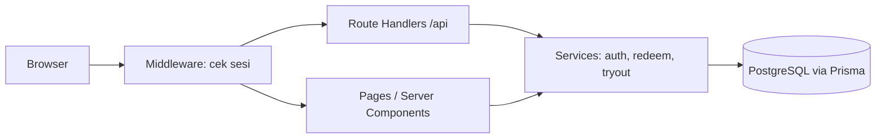

# PRD: latih.in, Website Tryout Online

**Proyek:** Technical test Full Stack Developer, PT Lini Suara Nusantara (Penerbit Buku Liniswara) **Penulis:** Muhammad Salman Alfarizy Yonda Putra **Versi:** 1.0 (23 November 2026) **Deadline pengumpulan:** Rabu, 25 November 2026, pukul 15.00 WIB **Status:** Siap dikerjakan

## 1. Ringkasan Eksekutif

latih.in adalah aplikasi web tryout online yang sederhana tempat pengguna mendaftar, mengaktifkan langganan memakai **kode redeem**, mempelajari materi lewat **video**, dan mengerjakan **simulasi tryout** berisi 10 soal, di mana setiap soal memuat 3 pernyataan yang dijawab Benar atau Salah. Aplikasi dilengkapi **landing page satu halaman**.

Proyek ini dikerjakan sebagai technical test dengan waktu terbatas (sekitar 2 hari kerja efektif). Karena itu, dokumen ini menetapkan prioritas yang tegas: seluruh fitur wajib dari soal dikerjakan hingga berjalan end-to-end (P0), fitur tambahan hanya dikerjakan bila waktu tersisa (P1/P2), dan semua alasan prioritas dicatat untuk README.

## 2. Latar Belakang & Masalah

Penerbit buku pendidikan membutuhkan platform tryout yang menggabungkan konten belajar (video) dan latihan soal dalam satu tempat, dengan akses berbasis langganan. Mekanisme kode redeem dipilih karena kode dapat dibagikan bersama produk fisik (buku) atau promosi, tanpa perlu payment gateway.

Masalah yang diselesaikan:

- Pengguna belum punya satu tempat untuk belajar lewat video dan langsung mengukur kemampuan lewat tryout.
- Penerbit butuh cara sederhana untuk mengendalikan akses konten berbayar tanpa integrasi pembayaran.
- Format soal Benar/Salah majemuk (3 pernyataan per soal) membutuhkan skoring yang jelas dan transparan.

## 3. Tujuan, Non-Tujuan, dan Metrik Keberhasilan

### 3.1 Tujuan

1. Kelima fitur wajib dari soal berfungsi end-to-end dan dapat dicoba reviewer tanpa setup rumit.
2. Konten materi dan tryout hanya dapat diakses pengguna dengan langganan aktif, dikontrol di sisi server.
3. Kode bersih, terstruktur, aman pada tingkat dasar, dan mudah dijalankan ulang.
4. Aplikasi ter-deploy di hosting gratis dan README menjelaskan hasil, fitur, serta prioritas.

### 3.2 Non-Tujuan

- Integrasi payment gateway dan pembelian langganan online.
- Verifikasi email, lupa password, dan login sosial.
- Upload dan hosting video sendiri (cukup embed YouTube).
- Fitur admin tingkat lanjut (editor rich-text, versioning soal, role admin bertingkat). Konten awal diisi lewat seed, dan pengelolaan konten lewat panel admin dikerjakan sesuai prioritas di bagian 5.
- Multi-bahasa, notifikasi push, dan aplikasi mobile native.

### 3.3 Metrik Keberhasilan (untuk evaluasi self-check)

| Metrik | Target |
| --- | --- |
| Alur akun baru → redeem → belajar → tryout → skor | Berjalan tanpa error di deploy production |
| Akses konten tanpa langganan lewat URL/API langsung | Selalu ditolak (401/403) |
| Kebocoran kunci jawaban sebelum submit | Tidak ada (diperiksa lewat DevTools network) |
| Waktu reviewer dari buka README sampai bisa mencoba | Kurang dari 3 menit (akun demo + kode demo tersedia) |
| Lighthouse (mobile) landing page | Performance dan Accessibility minimal 80 |

## 4. Persona & Skenario Pengguna

### 4.1 Persona

| Persona | Deskripsi | Kebutuhan utama |
| --- | --- | --- |
| **Pengguna (User)** | Pelajar yang menyiapkan ujian, memakai HP maupun laptop | Daftar cepat, redeem kode, belajar lewat video, ikut tryout, melihat skor dan pembahasan |
| **Admin** (opsional, P1) | Staf penerbit | Membuat kode redeem dan melihat status pemakaiannya |
| **Reviewer HRD/Teknis** | Penilai technical test | Mencoba cepat lewat akun demo, membaca README, melihat kualitas kode |

### 4.2 User Stories

| ID | Sebagai | Saya ingin | Agar | Prioritas |
| --- | --- | --- | --- | --- |
| US-01 | Pengguna | mendaftar dengan email dan password | punya akun pribadi | P0 |
| US-02 | Pengguna | login dan logout | akses saya aman | P0 |
| US-03 | Pengguna | memasukkan kode redeem | langganan saya aktif | P0 |
| US-04 | Pengguna | melihat sisa masa langganan | tahu kapan perlu memperpanjang | P0 |
| US-05 | Pengguna | melihat daftar materi video | memilih topik yang ingin dipelajari | P0 |
| US-06 | Pengguna | menonton video di dalam halaman | belajar tanpa meninggalkan situs | P0 |
| US-07 | Pengguna | mengerjakan tryout 10 soal | menguji pemahaman saya | P0 |
| US-08 | Pengguna | menjawab Benar/Salah untuk tiap pernyataan | mengikuti format soal yang ditetapkan | P0 |
| US-09 | Pengguna | melihat skor dan pembahasan setelah submit | tahu letak kesalahan saya | P0 |
| US-10 | Calon pengguna | melihat landing page yang menjelaskan produk | memahami manfaat dan cara mulai | P0 |
| US-11 | Pengguna | timer hitung mundur di tryout | berlatih dengan batas waktu nyata | P1 |
| US-12 | Pengguna | riwayat attempt tryout | memantau perkembangan skor | P1 |
| US-13 | Pengguna | menandai video yang sudah ditonton | melacak progres belajar | P1 |
| US-14 | Admin | membuat kode redeem baru | membagikannya ke pengguna | P1 |
| US-15 | Pengguna | mengulang tryout | berlatih berkali-kali | P2 |

### 4.3 Alur Utama (Happy Path)

1. Pengguna membuka landing page dan menekan **Daftar**.
2. Mengisi nama, email, password, lalu otomatis login dan masuk dashboard.
3. Dashboard menampilkan status "Belum berlangganan" dan tombol **Redeem Kode**.
4. Pengguna memasukkan kode, langganan aktif, dan dashboard menampilkan tanggal berakhir.
5. Pengguna membuka **Materi**, memilih video, dan menontonnya.
6. Pengguna membuka **Tryout**, menekan **Mulai**, menjawab 10 soal (30 pernyataan), lalu **Submit**.
7. Halaman hasil menampilkan skor, ringkasan per soal, dan pembahasan.

### 4.4 Matriks Hak Akses per Peran

Latih.in punya empat kondisi akses: tamu (belum login), user tanpa langganan, user dengan langganan aktif, dan admin. Semua aturan di bawah dijaga di server, bukan hanya disembunyikan di UI.

| Kapabilitas | Tamu | User tanpa langganan | User berlangganan | Admin |
| --- | --- | --- | --- | --- |
| Melihat landing page | Ya | Ya | Ya | Ya |
| Registrasi dan login | Ya | - | - | - (login lewat halaman yang sama) |
| Melihat dan mengubah profil, ganti password | Tidak | Ya | Ya | Ya |
| Redeem kode | Tidak | Ya | Ya (memperpanjang) | Ya (untuk uji coba) |
| Melihat daftar dan menonton materi video | Tidak | Tidak (terkunci, diarahkan ke redeem) | Ya | Ya |
| Mengerjakan tryout | Tidak | Tidak | Ya | Ya (mode uji, tidak masuk statistik) |
| Melihat hasil dan pembahasan | Tidak | Hanya attempt lama miliknya | Ya (miliknya) | Ya (semua attempt, read only) |
| Riwayat dan statistik pribadi | Tidak | Ya (data lama) | Ya | Ya |
| Panel admin (`/admin`) | Tidak | Tidak | Tidak | Ya |

### 4.5 Kapabilitas Pengguna (User)

User bisa mendaftar, berlangganan lewat kode redeem, belajar lewat video, dan mengerjakan tryout sebanyak yang ia mau selama langganannya aktif.

| Area | Yang bisa dilakukan user | Prioritas |
| --- | --- | --- |
| Akun | Registrasi, login, logout, melihat dan mengubah nama, ganti password | P0 (ganti password P1) |
| Langganan | Redeem kode, melihat status (aktif atau berakhir), tanggal berakhir, dan sisa hari | P0 |
| Langganan | Melihat riwayat kode yang pernah ditukar, serta banner pengingat saat sisa masa aktif 7 hari atau kurang | P1 |
| Materi | Melihat daftar materi dan menonton video penuh di halaman detail | P0 |
| Materi | Menandai materi selesai, melihat progres (x dari N materi), mencari materi berdasarkan judul | P1 |
| Tryout | Memulai atau melanjutkan tryout, menjawab 30 pernyataan (Benar/Salah), berpindah antarsoal, jawaban tersimpan otomatis, submit | P0 |
| Tryout | Melihat skor, jawaban sendiri versus kunci, dan pembahasan per pernyataan setelah submit | P0 |
| Tryout | Timer hitung mundur dengan auto-submit | P1 |
| Tryout | Melihat riwayat attempt dan membandingkan skor antarattempt | P1 |
| Tryout | Mengulang tryout dengan attempt baru tanpa batas jumlah selama langganan aktif | P1 |

**Batasan user**

- Tidak dapat melihat kunci jawaban dan pembahasan sebelum submit.
- Tidak dapat melihat data, hasil, atau langganan milik user lain.
- Saat langganan berakhir, materi dan tryout terkunci, tetapi data miliknya (hasil lama, riwayat, progres) tetap tersimpan dan bisa dilihat.
- Attempt yang sedang berjalan saat langganan berakhir tetap boleh diselesaikan dan disubmit, tetapi attempt baru tidak bisa dimulai.

### 4.6 Kapabilitas Admin

Admin mengelola kode redeem, konten belajar, pengguna, dan memantau hasil tryout lewat panel `/admin`. Akun admin dibuat lewat seed, tidak ada registrasi admin dari UI.

| Modul | Yang bisa dilakukan admin | Prioritas |
| --- | --- | --- |
| Dashboard | Melihat total user, user baru 7 hari terakhir, langganan aktif, langganan yang berakhir dalam 7 hari, kode tersedia dan terpakai, jumlah attempt, dan rata-rata skor | P1 |
| Kode redeem | Generate kode satuan atau batch (1 sampai 100 kode) dengan durasi hari, tanggal kedaluwarsa opsional, dan label batch (misalnya nama buku atau promo) | P1 |
| Kode redeem | Melihat daftar kode dengan filter status (tersedia, terpakai, kedaluwarsa, dicabut) dan pencarian, melihat siapa pemakainya dan kapan | P1 |
| Kode redeem | Mencabut kode yang belum dipakai dan mengekspor daftar kode ke CSV untuk dibagikan | P1 |
| Materi | Menambah, mengubah, dan mengarsipkan materi: judul, deskripsi, URL YouTube (divalidasi, ID diambil otomatis), urutan tampil, status draft atau terbit | P1 |
| Pengguna | Melihat daftar dan mencari pengguna (nama atau email), serta detail: status langganan, riwayat kode, dan attempt | P2 |
| Pengguna | Menonaktifkan atau mengaktifkan kembali akun, serta memberi atau mencabut langganan manual (jumlah hari dan alasan wajib diisi) | P2 |
| Soal tryout | Mengelola paket tryout, menambah dan mengubah soal beserta 3 pernyataan, kunci jawaban, dan pembahasan, dengan status draft atau terbit | P2 |
| Laporan | Melihat semua attempt (read only) dan statistik per pernyataan (persentase yang menjawab benar) untuk menemukan soal bermasalah | P2 |
| Audit | Semua aksi admin (generate, cabut, ubah konten, ubah status user) tercatat dengan pelaku, aksi, objek, dan waktu | P2 |

**Batasan admin**

- Semua rute `/admin` dan endpoint `/api/admin` dicek role ADMIN di server, dan non-admin mendapat 403.
- Admin tidak dapat melihat atau mengubah password user, dan tidak dapat menghapus akun user (hanya menonaktifkan).
- Admin tidak dapat menonaktifkan akunnya sendiri atau mengubah rolenya sendiri.
- Materi yang sudah punya data progres tidak dihapus permanen, hanya diarsipkan.
- Soal yang sudah dipakai attempt tidak boleh dihapus. Perubahan kunci jawaban menampilkan peringatan bahwa skor lama tidak dihitung ulang.

### 4.7 Paket Langganan dan Benefit

Latih.in memakai satu paket, **latih.in Premium**, yang diaktifkan lewat kode redeem. Tanpa langganan, user hanya bisa memakai akun dan mengaktifkan kode. Dengan langganan aktif, seluruh konten belajar dan latihan terbuka.

| Benefit | Tanpa langganan | Langganan aktif (Premium) |
| --- | --- | --- |
| Akun, dashboard, dan profil | Ya | Ya |
| Redeem kode | Ya | Ya (masa aktif diakumulasi) |
| Seluruh materi video | Tidak | Ya |
| Tryout simulasi (10 soal, 30 pernyataan) | Tidak | Ya, tanpa batas jumlah attempt |
| Skor dan pembahasan lengkap | Tidak | Ya |
| Timer tryout | Tidak | Ya (P1) |
| Penanda progres materi | Tidak | Ya (P1) |
| Riwayat attempt dan perbandingan skor | Hanya data lama | Ya |

**Aturan langganan**

- Durasi ditentukan per kode, dengan default 30 hari. Admin dapat membuat kode berdurasi lain (misalnya 7, 30, 90, atau 365 hari).
- Perpanjangan menambah masa aktif mulai dari tanggal berakhir yang sedang berlaku, bukan dari tanggal redeem.
- Status aktif dihitung dari `endsAt > now()`, sehingga tidak perlu job terjadwal.
- Saat langganan berakhir, konten premium terkunci, data milik user tetap tersimpan, dan attempt yang sedang berjalan boleh diselesaikan.
- Banner pengingat tampil 7 hari sebelum langganan berakhir (P1).
- Tidak ada pembayaran online dan tidak ada refund. Kode dibagikan lewat produk fisik (buku) atau promosi, dan admin dapat mencabut kode yang belum dipakai atau memberi dan mencabut langganan manual (P2).

## 5. Ruang Lingkup & Prioritas

| Prioritas | Fitur | Alasan pemilihan |
| --- | --- | --- |
| **P0** | Registrasi dan login, redeem dan guard langganan, materi video, tryout dan skoring, landing page | Kelima fitur ini adalah syarat eksplisit dari soal. Tanpa salah satunya, alur produk tidak utuh. |
| **P0** | Seed data (materi, soal, kode demo), deploy, README | Reviewer harus bisa mencoba tanpa setup. Deploy dan README termasuk bagian penilaian. |
| **P1** | Timer tryout dengan auto-submit | Membuat simulasi lebih realistis, biaya implementasi kecil. |
| **P1** | Riwayat attempt | Menambah nilai produk, memakai data yang sudah tersimpan. |
| **P1** | Penanda video ditonton | Memperkaya pengalaman belajar. |
| **P1** | Panel admin: dashboard statistik dan kelola kode redeem (generate, daftar, cabut, ekspor CSV) | Memudahkan demo dan menunjukkan sisi administrasi. |
| P1 | Panel admin: kelola materi video (tambah, ubah, arsipkan, urutkan) | Konten bisa dikelola tanpa mengubah seed atau database. Dikerjakan setelah kode redeem karena memakai pola CRUD yang sama. |
| **P2** | Reset tryout dan ranking | Hanya bila seluruh P0 dan P1 selesai dan stabil. |
| P2 | Panel admin: kelola pengguna, kelola soal tryout, laporan hasil, audit log | Melengkapi fungsi admin, tetapi seed sudah cukup untuk demo. Hanya dikerjakan jika seluruh P0 dan P1 stabil. |
| **Tidak dikerjakan** | Payment gateway, verifikasi email, lupa password, editor rich-text dan versioning soal | Di luar kebutuhan inti dan berisiko menghabiskan waktu. Dicatat sebagai pengembangan lanjutan. |

**Prinsip prioritas:** (1) kebutuhan wajib dari soal dulu, (2) kebenaran dan keamanan alur inti sebelum fitur tambahan, (3) hal yang langsung terlihat reviewer (deploy, README, demo) tidak boleh dikorbankan demi fitur ekstra.

## 6. Kebutuhan Fungsional

### F1. Registrasi dan Login (P0)

**Deskripsi:** Pengguna membuat akun dan masuk ke aplikasi.

**Aturan bisnis**

- Field registrasi: nama (2–80 karakter), email (format valid, unik, disimpan lowercase), password (minimal 8 karakter, berisi huruf dan angka).
- Password di-hash dengan bcrypt (cost 10–12). Password plain tidak boleh disimpan atau tercatat di log.
- Setelah registrasi sukses, pengguna langsung login.
- Sesi memakai JWT yang disimpan di cookie `httpOnly`, `SameSite=Lax`, dan `Secure` di production, dengan masa berlaku 7 hari.
- Rute terproteksi me-redirect ke `/login` bila tidak ada sesi valid, dan setelah login kembali ke halaman tujuan semula.
- Pesan error login bersifat umum ("Email atau password salah") agar tidak membocorkan keberadaan akun.
- Rate limit sederhana pada login dan registrasi, misalnya 10 percobaan per menit per IP.

**Acceptance criteria**

- [ ] Email duplikat ditolak dengan pesan "Email sudah terdaftar".
- [ ] Input tidak valid menampilkan pesan per field (validasi Zod di client dan server).
- [ ] Password tersimpan sebagai hash di database.
- [ ] Akses langsung ke `/dashboard`, `/materi`, `/tryout` tanpa sesi diarahkan ke `/login`.
- [ ] Logout menghapus cookie sesi.

### F2. Langganan via Kode Redeem (P0)

**Deskripsi:** Langganan diaktifkan dengan memasukkan kode redeem.

**Aturan bisnis**

- Format kode: 10–12 karakter alfanumerik huruf besar, dengan pengelompokan tampilan `XXXX-XXXX-XXXX`. Input dinormalisasi (trim, uppercase, tanpa tanda hubung) sebelum dicek.
- Setiap kode memiliki `durationDays` (default 30) dan opsional `expiresAt` (batas akhir kode boleh ditukar).
- Kode **sekali pakai**. Setelah dipakai, kode ditandai `isUsed`, dengan `usedById` dan `usedAt`.
- Jika pengguna sudah punya langganan aktif, masa aktif **diperpanjang** mulai dari `endsAt` yang berlaku. Jika tidak, dihitung dari saat redeem.
- Proses redeem harus **atomik**: pengecekan dan penandaan kode dilakukan dalam satu transaksi DB sehingga dua request bersamaan tidak bisa memakai kode yang sama.
- Status langganan aktif ditentukan oleh `endsAt > now()`. Tidak ada job terjadwal, status dihitung saat dibaca.

**Pesan error yang spesifik**

| Kondisi | Pesan |
| --- | --- |
| Kode tidak ditemukan | "Kode redeem tidak valid" |
| Kode sudah dipakai | "Kode redeem sudah digunakan" |
| Kode kedaluwarsa | "Kode redeem sudah kedaluwarsa" |
| Terlalu banyak percobaan | "Terlalu banyak percobaan, coba lagi nanti" |

**Acceptance criteria**

- [ ] Redeem kode valid mengaktifkan langganan dan dashboard menampilkan tanggal berakhir.
- [ ] Redeem kedua dengan kode yang sama gagal.
- [ ] Dua request paralel dengan kode sama menghasilkan tepat satu sukses.
- [ ] Redeem saat langganan aktif memperpanjang, bukan menimpa.
- [ ] Rate limit aktif pada endpoint redeem untuk mencegah tebak kode.

### F3. Materi Belajar Video (P0)

**Deskripsi:** Daftar dan pemutar materi video berbasis YouTube.

**Aturan bisnis**

- Materi memiliki judul, deskripsi, URL YouTube (disimpan sebagai `youtubeId`), urutan, dan durasi (opsional).
- Minimal 5 materi tersedia lewat seed.
- Video di-embed lewat `https://www.youtube-nocookie.com/embed/{youtubeId}` dengan iframe responsif (rasio 16:9).
- Hanya pengguna dengan langganan aktif yang dapat membuka daftar dan detail materi. Pengguna tanpa langganan melihat halaman penjelasan dengan tombol ke halaman redeem.
- Pengecekan langganan dilakukan di server (middleware atau service), bukan hanya disembunyikan di UI.
- (P1) Tombol "Tandai selesai" menyimpan progres per pengguna, dan daftar materi menampilkan penanda selesai.

**Acceptance criteria**

- [ ] Pengguna berlangganan melihat daftar dan dapat memutar video.
- [ ] Pengguna tanpa langganan yang mengakses `/materi/[id]` atau `/api/materials` mendapat penolakan.
- [ ] Halaman nyaman dipakai di layar HP.

### F4. Simulasi Tryout (P0)

**Deskripsi:** Pengguna mengerjakan satu paket tryout berisi 10 soal. Setiap soal memiliki 3 pernyataan yang masing-masing dijawab **Benar** atau **Salah**.

**Struktur soal**

- 1 paket tryout, 10 soal, 30 pernyataan.
- Setiap soal: teks soal atau stimulus (boleh berisi bacaan singkat), lalu 3 pernyataan.
- Setiap pernyataan memiliki kunci jawaban (`isTrue`) dan penjelasan singkat.
- Seed menyediakan 10 soal bermakna (konten contoh bebas, misalnya materi umum seperti literasi atau penalaran).

**Alur tryout**

1. Pengguna menekan **Mulai Tryout**, dan server membuat `Attempt` baru berstatus `IN_PROGRESS`.
2. Jika sudah ada attempt `IN_PROGRESS`, pengguna melanjutkan attempt tersebut (tidak membuat attempt ganda).
3. Layar pengerjaan: satu soal per layar, navigasi nomor soal (1–10) dengan penanda sudah terjawab, tombol Sebelumnya dan Berikutnya.
4. Setiap perubahan jawaban disimpan otomatis ke server (debounce), sehingga progres aman saat refresh.
5. Tombol **Submit** menampilkan konfirmasi dan jumlah pernyataan yang belum dijawab. Pernyataan kosong dihitung salah.
6. Server menghitung skor, mengubah status menjadi `SUBMITTED`, lalu mengarahkan ke halaman hasil.

**Aturan skoring**

- 1 poin untuk setiap pernyataan yang dijawab benar. Skor maksimum 30.
- Skor akhir juga ditampilkan dalam skala 0–100: `skor = (poin / 30) × 100`, dibulatkan 1 desimal.
- Statistik tambahan per soal: jumlah pernyataan benar (0–3).
- Aturan ini ditulis di README agar transparan dan mudah diubah (misalnya skema "soal benar hanya jika ketiga pernyataan benar" dapat dijadikan opsi pengembangan).

**Halaman hasil**

- Skor total, skala 0–100, dan waktu pengerjaan.
- Daftar 10 soal dengan indikator per pernyataan: jawaban pengguna, kunci, benar atau salah, dan penjelasan.

**Keamanan dan integritas**

- Kunci jawaban dan penjelasan **tidak** dikirim ke client selama attempt `IN_PROGRESS`. Keduanya baru dikirim setelah submit.
- Penilaian dihitung di server.
- Attempt yang sudah `SUBMITTED` tidak bisa diubah atau disubmit ulang.
- Pengguna hanya bisa mengakses attempt miliknya sendiri (cek `userId` pada setiap endpoint).
- Hanya pengguna dengan langganan aktif yang dapat memulai attempt.

**P1: Timer dan riwayat**

- Timer hitung mundur (default 20 menit) dihitung dari `startedAt` di server, jadi refresh tidak mereset waktu. Saat habis, attempt otomatis disubmit.
- Halaman riwayat menampilkan daftar attempt (tanggal, skor, durasi) dengan link ke hasil.

**Acceptance criteria**

- [ ] Payload soal saat pengerjaan tidak mengandung `isTrue` atau `explanation`.
- [ ] Refresh halaman tidak menghilangkan jawaban yang sudah dipilih.
- [ ] Submit kedua pada attempt yang sama ditolak.
- [ ] Skor yang tampil sesuai perhitungan manual untuk minimal satu kasus uji.
- [ ] Pengguna lain tidak bisa membuka hasil attempt orang lain (404/403).

### F5. Landing Page Satu Halaman (P0)

**Deskripsi:** Halaman publik tunggal di `/` yang memperkenalkan produk dan mengarahkan ke pendaftaran.

**Section**

1. **Navbar** dengan anchor (Fitur, Cara Kerja, Materi, FAQ), tombol Masuk dan Daftar. Jika sudah login, tombol berubah menjadi Dashboard.
2. **Hero:** headline, subjudul, CTA utama "Mulai Sekarang", dan ilustrasi atau mockup.
3. **Fitur:** kartu untuk Materi Video, Simulasi Tryout, Skor dan Pembahasan, serta Akses via Kode Redeem.
4. **Cara Kerja:** 4 langkah (Daftar, Redeem, Belajar, Tryout).
5. **Cuplikan materi:** 3 kartu materi contoh (judul dan thumbnail saja, tanpa akses video).
6. **FAQ:** 4–5 pertanyaan (cara dapat kode, masa aktif, jumlah soal, dll.).
7. **CTA akhir dan Footer.**

**Acceptance criteria**

- [ ] Seluruh section berada dalam satu halaman dengan smooth scroll.
- [ ] Responsif di lebar 360px hingga desktop.
- [ ] Memiliki meta title, description, dan Open Graph dasar.

### F6. Panel Admin (P1 dan P2)

**Deskripsi:** Panel di `/admin` untuk mengelola kode redeem, konten, dan pengguna. Rincian kapabilitas ada di bagian 4.6, dan dikerjakan bertahap sesuai prioritas.

**Aturan bisnis**

- Akses `/admin` dan `/api/admin/*` hanya untuk role ADMIN, dicek di middleware dan di setiap service.
- Generate kode: jumlah 1 sampai 100 per batch, durasi 1 sampai 730 hari, kode acak 12 karakter tanpa karakter ambigu (0, O, 1, I), unik di database (ulangi bila bentrok).
- Kode yang dicabut tidak dapat ditukar dan menampilkan pesan "Kode redeem sudah dicabut". Kode yang sudah dipakai tidak dapat dicabut.
- Ekspor CSV berisi kode, durasi, status, label batch, dan tanggal kedaluwarsa.
- Input URL materi divalidasi sebagai tautan YouTube dan ID videonya diambil otomatis.
- Daftar admin memakai paginasi (20 baris per halaman) dan pencarian sederhana.
- Setiap aksi admin yang mengubah data dicatat di audit log (P2).

**Acceptance criteria**

- [ ] User biasa yang membuka `/admin` atau memanggil `/api/admin/*` mendapat 403.
- [ ] Admin dapat generate 10 kode sekaligus dan semuanya unik serta muncul di daftar.
- [ ] Kode yang dicabut gagal ditukar dengan pesan yang jelas.
- [ ] Materi baru berstatus terbit langsung tampil untuk user berlangganan, dan yang diarsipkan hilang dari daftar.
- [ ] Admin tidak bisa menonaktifkan akunnya sendiri (P2).
- [ ] Ekspor CSV dapat dibuka di spreadsheet dan jumlah barisnya sesuai filter.

## 7. Kebutuhan Non-Fungsional

### 7.1 Keamanan

- Hash password bcrypt, cookie `httpOnly` dan `SameSite`, serta validasi Zod di semua input.
- Otorisasi dicek di server pada setiap endpoint (sesi, langganan, kepemilikan attempt).
- Rate limit pada login, registrasi, dan redeem.
- Tidak ada secret yang ter-commit. Semua lewat environment variable dan disediakan `.env.example`.
- Query lewat Prisma (parameterized) untuk mencegah SQL injection, dan output React yang ter-escape untuk mencegah XSS.
- Header keamanan dasar (CSP sederhana, `X-Content-Type-Options`, `Referrer-Policy`) lewat konfigurasi Next.js bila waktu cukup.

### 7.2 Performa dan Keandalan

- Halaman publik di-render statis, dan halaman terproteksi dirender dinamis.
- Waktu respons API normal di bawah 500 ms pada free tier.
- Koneksi database memakai pooling (Neon pooled connection atau Prisma Accelerate alternatif) agar aman di serverless.
- Tidak menyimpan state di memori server (kompatibel dengan Vercel serverless).

### 7.3 Usability dan Aksesibilitas

- Mobile-first, target sentuh minimal 44px, kontras warna memadai.
- Loading state, empty state, dan error state ada di setiap halaman data.
- Seluruh teks antarmuka berbahasa Indonesia.
- Form dapat dioperasikan dengan keyboard, dengan label yang terhubung ke input.

### 7.4 Kualitas Kode

- TypeScript mode `strict`, ESLint dan Prettier aktif.
- Pemisahan layer: route handler tipis, logika bisnis di `services/`, akses data di `repositories/` atau langsung Prisma di service, dan validasi di `lib/validators/`.
- Commit kecil dengan pesan bermakna (mis. `feat(redeem): atomic redeem code transaction`).
- Minimal beberapa unit test untuk logika kritis (skoring dan redeem) bila waktu memungkinkan.

## 8. Arsitektur & Tech Stack

### 8.1 Keputusan Arsitektur: Monolit Fullstack TypeScript

Aplikasi dibangun sebagai **satu repository dan satu aplikasi Next.js** (frontend dan backend dalam satu project), seluruhnya TypeScript.

**Alasan**

- Waktu pengerjaan sangat terbatas. Satu project menghilangkan waktu untuk konfigurasi CORS, dua pipeline deploy, dan sinkronisasi tipe lintas project.
- Cookie sesi bekerja dalam satu domain, sehingga bebas masalah cookie lintas origin.
- Deploy gratis cukup satu service (Vercel) ditambah satu database (Neon/Supabase).
- Tipe data dan skema validasi Zod dipakai bersama oleh UI dan API.
- Pemisahan tanggung jawab tetap ditunjukkan lewat struktur layer internal.

**Trade-off yang diterima:** kurang menonjolkan pemisahan service secara fisik, dan skalabilitas terpisah antara frontend dan backend tidak diperlukan pada skala ini. Jika kelak dibutuhkan, service layer dapat diekstrak ke backend terpisah (Express/NestJS) dengan perubahan minimal.

### 8.2 Stack

| Layer | Teknologi | Catatan |
| --- | --- | --- |
| Framework | Next.js 15 (App Router) | Server Components, Route Handlers, Middleware |
| Bahasa | TypeScript (strict) | Seluruh codebase |
| Database | PostgreSQL | Neon atau Supabase (free tier) |
| ORM | Prisma | Skema, migrasi, dan seed (`prisma/seed.ts`) |
| Auth | `jose` (JWT) + `bcryptjs` | Sesi di cookie httpOnly |
| Validasi | Zod | Dipakai di client dan server |
| UI | Tailwind CSS + shadcn/ui | Komponen aksesibel dan cepat dibuat |
| Form | React Hook Form | Resolver Zod |
| Ikon | lucide-react |  |
| Video | Embed YouTube nocookie | Tanpa storage |
| Rate limit | Tabel DB sederhana atau `@upstash/ratelimit` (opsional) | Pilih yang paling cepat diimplementasi |
| Tooling | ESLint, Prettier, `tsx` |  |
| Deploy | Vercel | Env var lewat dashboard |

### 8.3 Struktur Folder

```
/
├─ prisma/
│  ├─ schema.prisma
│  └─ seed.ts
├─ src/
│  ├─ app/
│  │  ├─ (public)/            # landing, login, register
│  │  ├─ (app)/               # dashboard, redeem, materi, tryout
│  │  ├─ (admin)/admin/       # generate kode (P1)
│  │  └─ api/                 # route handlers
│  ├─ components/             # ui/, landing/, tryout/, layout/
│  ├─ lib/
│  │  ├─ auth.ts              # sign/verify JWT, getSession
│  │  ├─ db.ts                # Prisma client singleton
│  │  ├─ errors.ts            # AppError, mapper ke HTTP
│  │  └─ validators/          # skema Zod
│  ├─ services/               # auth, redeem, subscription, material, tryout
│  └─ middleware.ts           # proteksi rute
├─ .env.example
└─ README.md
```

### 8.4 Diagram Alur Tingkat Tinggi



## 9. Model Data

### 9.1 Skema (Prisma, ringkas)

```prisma
enum Role { USER ADMIN }
enum AttemptStatus { IN_PROGRESS SUBMITTED }

model User {
  id           String   @id @default(cuid())
  name         String
  email        String   @unique
  passwordHash String
  role         Role     @default(USER)
  createdAt    DateTime @default(now())
  subscriptions Subscription[]
  attempts      Attempt[]
  progress      MaterialProgress[]
}

model RedeemCode {
  id           String    @id @default(cuid())
  code         String    @unique
  durationDays Int       @default(30)
  expiresAt    DateTime?
  isUsed       Boolean   @default(false)
  usedById     String?
  usedAt       DateTime?
  createdAt    DateTime  @default(now())
  subscription Subscription?
}

model Subscription {
  id           String   @id @default(cuid())
  userId       String
  codeId       String   @unique
  startsAt     DateTime
  endsAt       DateTime
  user         User       @relation(fields: [userId], references: [id])
  code         RedeemCode @relation(fields: [codeId], references: [id])
  @@index([userId, endsAt])
}

model Material {
  id          String @id @default(cuid())
  title       String
  description String
  youtubeId   String
  order       Int
  progress    MaterialProgress[]
}

model MaterialProgress {
  id         String   @id @default(cuid())
  userId     String
  materialId String
  watchedAt  DateTime @default(now())
  @@unique([userId, materialId])
}

model Tryout {
  id              String     @id @default(cuid())
  title           String
  durationMinutes Int        @default(20)
  questions       Question[]
  attempts        Attempt[]
}

model Question {
  id         String      @id @default(cuid())
  tryoutId   String
  order      Int
  stem       String
  statements Statement[]
  @@unique([tryoutId, order])
}

model Statement {
  id          String  @id @default(cuid())
  questionId  String
  order       Int
  text        String
  isTrue      Boolean
  explanation String
  @@unique([questionId, order])
}

model Attempt {
  id          String        @id @default(cuid())
  userId      String
  tryoutId    String
  status      AttemptStatus @default(IN_PROGRESS)
  startedAt   DateTime      @default(now())
  submittedAt DateTime?
  score       Int?
  answers     AttemptAnswer[]
  @@index([userId, status])
}

model AttemptAnswer {
  id          String  @id @default(cuid())
  attemptId   String
  statementId String
  answer      Boolean
  @@unique([attemptId, statementId])
}
```

### 9.2 Relasi dan Aturan Integritas

- `Question` memiliki tepat 3 `Statement` (dijamin oleh seed dan divalidasi di script seed).
- `AttemptAnswer` unik per `(attemptId, statementId)` sehingga mengubah jawaban berarti `upsert`.
- Satu `RedeemCode` hanya menghasilkan satu `Subscription` (`codeId` unik).
- Langganan aktif pengguna = `Subscription` dengan `endsAt` terbesar yang lebih besar dari `now()`.
- Hanya satu `Attempt` berstatus `IN_PROGRESS` per pengguna per tryout (dijaga di service).

### 9.3 Tambahan Skema untuk Panel Admin dan Langganan

Skema di 9.1 ditambah field dan model berikut. Perubahan penting: `Subscription.codeId` menjadi opsional karena langganan manual dari admin tidak punya kode.

```prisma
enum ContentStatus { DRAFT PUBLISHED }
enum SubscriptionSource { REDEEM MANUAL }

model User {
  isActive Boolean @default(true)       // admin dapat menonaktifkan
}

model RedeemCode {
  label        String?                  // label batch, mis. nama buku atau promo
  revokedAt    DateTime?                // terisi bila dicabut admin
  revokedById  String?
  createdById  String?                  // admin pembuat
}

model Subscription {
  codeId       String?  @unique         // null untuk langganan manual
  source       SubscriptionSource @default(REDEEM)
  grantedById  String?                  // admin pemberi (MANUAL)
  note         String?                  // alasan pemberian atau pencabutan
}

model Material {
  status ContentStatus @default(PUBLISHED)   // DRAFT = diarsipkan
}

model Tryout {
  status ContentStatus @default(PUBLISHED)
}

model AuditLog {                          // P2
  id         String   @id @default(cuid())
  actorId    String
  action     String                       // mis. CODE_GENERATED, USER_DEACTIVATED
  entityType String
  entityId   String?
  meta       Json?
  createdAt  DateTime @default(now())
  @@index([entityType, createdAt])
}
```

Attempt yang dibuat admin (mode uji) ditandai lewat field `isTest Boolean @default(false)` pada `Attempt` agar tidak masuk statistik.

## 10. Spesifikasi API

Semua endpoint berformat JSON. Error memakai bentuk seragam:

```json
{ "error": { "code": "CODE_ALREADY_USED", "message": "Kode redeem sudah digunakan" } }
```

| Method | Endpoint | Auth | Langganan | Deskripsi |
| --- | --- | --- | --- | --- |
| POST | `/api/auth/register` | Tidak | Tidak | Buat akun, set cookie sesi |
| POST | `/api/auth/login` | Tidak | Tidak | Login, set cookie sesi |
| POST | `/api/auth/logout` | Ya | Tidak | Hapus cookie sesi |
| GET | `/api/me` | Ya | Tidak | Profil dan status langganan |
| POST | `/api/redeem` | Ya | Tidak | Tukar kode redeem |
| GET | `/api/materials` | Ya | **Aktif** | Daftar materi (dan penanda ditonton) |
| GET | `/api/materials/[id]` | Ya | **Aktif** | Detail materi |
| POST | `/api/materials/[id]/progress` | Ya | **Aktif** | Tandai selesai (P1) |
| POST | `/api/tryout/start` | Ya | **Aktif** | Mulai atau lanjutkan attempt |
| GET | `/api/tryout/[attemptId]` | Ya | **Aktif** | Soal dan jawaban tersimpan (tanpa kunci) |
| PUT | `/api/tryout/[attemptId]/answers` | Ya | **Aktif** | Simpan jawaban (upsert) |
| POST | `/api/tryout/[attemptId]/submit` | Ya | **Aktif** | Hitung skor dan kunci attempt |
| GET | `/api/tryout/[attemptId]/result` | Ya | Tidak | Hasil dan pembahasan (hanya `SUBMITTED`) |
| GET | `/api/tryout/history` | Ya | Tidak | Riwayat attempt (P1) |
| POST | `/api/admin/redeem-codes` | Admin | Tidak | Generate kode (P1) |

### Contoh Kontrak Utama

**POST `/api/redeem`**

```json
// request
{ "code": "ABCD-EFGH-JKLM" }
// 200
{ "subscription": { "startsAt": "2026-11-23T08:00:00Z", "endsAt": "2026-12-23T08:00:00Z" } }
```

**PUT `/api/tryout/[attemptId]/answers`**

```json
// request
{ "answers": [ { "statementId": "clx...", "answer": true } ] }
// 200
{ "saved": 1 }
```

**POST `/api/tryout/[attemptId]/submit`**

```json
// 200
{ "attemptId": "clx...", "score": 24, "max": 30, "percent": 80.0 }
```

### Rute Halaman

| Rute | Akses | Keterangan |
| --- | --- | --- |
| `/` | Publik | Landing page |
| `/login`, `/register` | Publik (redirect bila sudah login) | Autentikasi |
| `/dashboard` | Login | Status langganan dan akses cepat |
| `/redeem` | Login | Form kode redeem |
| `/materi`, `/materi/[id]` | Login + langganan | Daftar dan pemutar video |
| `/tryout` | Login + langganan | Intro dan tombol mulai/lanjut |
| `/tryout/[attemptId]` | Login + langganan | Layar pengerjaan |
| `/tryout/[attemptId]/hasil` | Login (pemilik) | Skor dan pembahasan |
| `/riwayat` | Login | Riwayat attempt (P1) |
| `/admin/kode` | Admin | Generate kode (P1) |

### Endpoint dan Rute Admin

Semua endpoint ini memerlukan role ADMIN. Endpoint `POST /api/admin/redeem-codes` di tabel sebelumnya mengikuti rincian di sini.

| Method | Endpoint | Deskripsi | Prioritas |
| --- | --- | --- | --- |
| GET | `/api/admin/stats` | Statistik dashboard | P1 |
| GET | `/api/admin/redeem-codes` | Daftar kode (filter status, pencarian, paginasi) | P1 |
| POST | `/api/admin/redeem-codes` | Generate kode satuan atau batch | P1 |
| POST | `/api/admin/redeem-codes/[id]/revoke` | Cabut kode yang belum dipakai | P1 |
| GET | `/api/admin/redeem-codes/export` | Ekspor CSV sesuai filter | P1 |
| GET, POST | `/api/admin/materials` | Daftar dan tambah materi | P1 |
| PUT, PATCH | `/api/admin/materials/[id]` | Ubah materi, ubah status (arsipkan), atur urutan | P1 |
| GET | `/api/admin/users`, `/api/admin/users/[id]` | Daftar dan detail pengguna | P2 |
| PATCH | `/api/admin/users/[id]` | Aktifkan atau nonaktifkan akun | P2 |
| POST | `/api/admin/users/[id]/subscription` | Beri atau cabut langganan manual | P2 |
| GET, POST, PUT | `/api/admin/tryouts`, `/api/admin/questions` | Kelola paket, soal, pernyataan, kunci, dan pembahasan | P2 |
| GET | `/api/admin/attempts`, `/api/admin/analytics/statements` | Semua attempt dan statistik per pernyataan | P2 |
| GET | `/api/admin/audit-logs` | Riwayat aksi admin | P2 |

| Rute admin | Isi |
| --- | --- |
| `/admin` | Dashboard statistik |
| `/admin/kode` | Kelola kode redeem |
| `/admin/materi` | Kelola materi video |
| `/admin/pengguna` | Kelola pengguna (P2) |
| `/admin/tryout` | Kelola soal tryout (P2) |
| `/admin/laporan` | Laporan attempt dan statistik soal (P2) |

## 11. Rancangan UI/UX

- **Gaya:** bersih, ramah pelajar, dominan warna primer tunggal dengan aksen, memakai komponen shadcn/ui.
- **Navigasi (setelah login):** sidebar atau bottom-nav di mobile berisi Dashboard, Materi, Tryout, Riwayat.
- **Dashboard:** kartu status langganan (aktif/tidak, sisa hari), kartu Lanjut Belajar, dan kartu Tryout terakhir.
- **Layar tryout:** header (nomor soal, timer P1), area soal dan 3 pernyataan masing-masing dengan toggle Benar/Salah, peta nomor soal, serta tombol navigasi dan Submit.
- **Hasil:** angka skor besar, ringkasan, lalu akordeon per soal berisi pembahasan.
- **Empty/Error state:** pesan ramah dengan aksi lanjutan (mis. "Belum berlangganan, Redeem kode sekarang").

### 11.1 Identitas Merek: latih.in

Nama aplikasi adalah **latih.in**, selalu ditulis huruf kecil dengan titik. Nama ini memadukan kata "latih" (berlatih) dengan akhiran ".in" yang juga terdengar seperti "latihin" dalam percakapan sehari-hari, sehingga terasa akrab bagi pelajar.

**Logo.** Logo berupa wordmark tanpa ikon: "latih" berwarna navy gelap, sedangkan titik dan "in" berwarna biru terang. Hurufnya tebal, geometris, dan bersudut membulat. Sumbernya adalah gambar logo yang diunggah (PNG, 2172 x 724 px) dan disimpan di `public/brand/logo.png`.

| Token | Warna | Pemakaian |
| --- | --- | --- |
| `brand-navy` | #001031 | Teks utama, heading, kata "latih" pada logo |
| `brand-blue` | #0048FC | Aksen, tombol utama, tautan, bagian ".in" pada logo |
| `surface` | #FFFFFF | Latar utama halaman |
| `brand-blue-50` | #EAF0FF | Turunan biru muda untuk latar section, hover, dan badge |
| `success`, `danger` | Hijau dan merah standar Tailwind | Jawaban benar dan salah, pesan status |

**Tipografi.** Heading memakai Poppins (bobot 600 sampai 800) yang paling dekat dengan karakter huruf logo, dan teks isi memakai Inter. Keduanya dimuat lewat `next/font/google`.

**Aturan pemakaian**

- Di navbar, logo setinggi 28 sampai 32 px dan menjadi tautan ke `/`. Di footer dan halaman login atau registrasi, logo tampil di tengah.
- Beri ruang kosong di sekeliling logo minimal setinggi huruf "i". Warna dan proporsi logo tidak diubah.
- Di latar gelap, "latih" berubah menjadi putih dan ".in" tetap biru terang (varian dibuat bila waktu cukup).
- Favicon sederhana: huruf "l" navy dengan titik biru, dibuat sebagai SVG.
- Judul halaman: "latih.in | Latihan Soal dan Tryout Online". Tagline: "Belajar dari video, latihan lewat tryout."
- Nama repository `latih-in`, nama paket `latih-in`.
- Gaya bahasa antarmuka santai tapi jelas, dalam Bahasa Indonesia, dan menyapa user dengan "kamu".

## 12. Seed Data & Akun Demo

Seed (`npx prisma db seed`) wajib membuat:

- 1 akun admin: `admin@demo.test` (password dicantumkan di README demo).
- 1 akun user demo tanpa langganan: `user@demo.test`.
- 5 materi video YouTube (tautan publik yang relevan).
- 1 paket tryout dengan 10 soal dan 30 pernyataan beserta kunci dan pembahasan.
- 5 kode redeem demo (durasi 30 hari) yang dicantumkan di README.

Seed harus idempotent (aman dijalankan ulang) dan memvalidasi bahwa setiap soal memiliki tepat 3 pernyataan.

## 13. Rencana Pengujian

### 13.1 Skenario Uji Manual (checklist sebelum submit)

| # | Skenario | Hasil yang diharapkan |
| --- | --- | --- |
| 1 | Registrasi dengan email baru | Berhasil dan masuk dashboard |
| 2 | Registrasi email yang sama | Ditolak dengan pesan jelas |
| 3 | Akses `/materi` tanpa login | Redirect ke login |
| 4 | Akses `/materi` setelah login tanpa langganan | Diarahkan ke halaman redeem |
| 5 | Redeem kode valid | Langganan aktif, tanggal tampil |
| 6 | Redeem kode yang sama lagi | Ditolak |
| 7 | Redeem kode kedaluwarsa | Ditolak |
| 8 | Buka detail materi dan putar video | Video tampil dan bisa diputar |
| 9 | Mulai tryout dan jawab sebagian lalu refresh | Jawaban tetap tersimpan |
| 10 | Cek tab Network saat tryout | Tidak ada `isTrue` atau `explanation` |
| 11 | Submit tryout | Skor sesuai perhitungan manual |
| 12 | Submit ulang attempt yang sama | Ditolak |
| 13 | Buka hasil attempt milik user lain | 403/404 |
| 14 | Tampilan di lebar 360px | Tidak ada elemen terpotong |

### 13.2 Uji Otomatis (bila waktu cukup)

- Unit test fungsi skoring (semua benar, semua salah, sebagian kosong).
- Unit test logika perpanjangan langganan (aktif vs kedaluwarsa).
- Tes konkurensi redeem (dua request bersamaan, satu sukses).

### 13.3 Uji Peran Admin dan Langganan

| # | Skenario | Hasil yang diharapkan |
| --- | --- | --- |
| 15 | User biasa membuka `/admin` atau memanggil `/api/admin/stats` | 403 atau redirect |
| 16 | Admin generate 10 kode berdurasi 30 hari | 10 kode unik tampil di daftar berstatus tersedia |
| 17 | Admin mencabut kode lalu user mencoba redeem | Ditolak dengan pesan kode dicabut |
| 18 | Admin mengekspor CSV dengan filter "terpakai" | Jumlah baris sesuai filter |
| 19 | Admin menambah materi berstatus terbit | Materi tampil di daftar user berlangganan |
| 20 | Admin mengarsipkan materi | Materi hilang dari daftar user |
| 21 | Langganan user berakhir saat attempt berjalan | Attempt bisa disubmit, attempt baru ditolak |
| 22 | User berlangganan menukar kode kedua | Masa aktif bertambah dari tanggal berakhir |
| 23 | Admin menonaktifkan user lalu user login (P2) | Login ditolak |
| 24 | Admin memberi langganan manual 7 hari (P2) | Status aktif dan tanggal berakhir bertambah 7 hari |
| 25 | Aksi admin dilakukan (P2) | Tercatat di audit log |

## 14. Deployment

1. Buat database di Neon atau Supabase dan salin connection string (pooled).
2. Siapkan environment variable: `DATABASE_URL`, `JWT_SECRET`, `APP_URL`.
3. Hubungkan repository GitHub ke Vercel (build command `prisma generate && next build`).
4. Jalankan `prisma migrate deploy` dan `prisma db seed` terhadap database production.
5. Uji seluruh checklist 13.1 pada URL production.
6. Cantumkan URL deploy, akun demo, dan kode redeem demo di README.

## 15. Struktur README (Wajib)

1. Judul, deskripsi singkat, dan **link demo**.
2. **Akun demo dan kode redeem demo** untuk reviewer.
3. Daftar fitur: selesai, sebagian, dan tidak dikerjakan.
4. **Prioritas pengerjaan dan alasannya** (ketentuan nomor 1 dari soal), mengacu ke bagian 5 dokumen ini.
5. Tech stack dan keputusan teknis (alasan monolit, aturan skoring, strategi keamanan kunci jawaban).
6. Cara menjalankan lokal: prasyarat, `.env`, `npm install`, `prisma migrate dev`, `prisma db seed`, `npm run dev`.
7. Struktur proyek singkat.
8. Keterbatasan yang diketahui dan rencana pengembangan lanjutan.
9. Catatan penggunaan AI assistant (jujur menyebut bagian yang dibantu AI).

## 16. Rencana Waktu (23–25 November 2026)

| Waktu | Target | Output |
| --- | --- | --- |
| **Senin 23 Nov** | Setup repo, Next.js, Prisma, skema, seed. Auth (register, login, middleware). Redeem dan guard langganan. | Akun, sesi, dan langganan berfungsi |
| **Selasa 24 Nov** | Materi video. Tryout lengkap (start, autosave, submit, hasil). Landing page. | Semua fitur P0 berjalan di lokal |
| **Rabu 25 Nov pagi** | Polish UI, P1 yang sempat (timer, riwayat, admin kode), deploy, uji checklist production, tulis README. | Aplikasi live dan README final |
| **Rabu 25 Nov ≤ 13.00** | **Submit lebih awal** sebagai buffer 2 jam sebelum batas 15.00. | Link repo dan deploy terkirim |

**Aturan pemangkasan:** jika waktu mepet, korbankan P1 dan P2 terlebih dahulu. Jangan korbankan keamanan guard langganan, kerahasiaan kunci jawaban, deploy, dan README.

## 17. Risiko & Mitigasi

| Risiko | Dampak | Mitigasi |
| --- | --- | --- |
| Waktu tidak cukup | Fitur wajib tidak selesai | Prioritas P0 dulu, P1 dipangkas, monolit untuk mengurangi setup |
| Masalah koneksi DB di serverless | Error di production | Pakai pooled connection string dan Prisma client singleton |
| Kegagalan deploy menjelang deadline | Tidak ada link demo | Deploy awal pada hari kedua (jangan menunggu hari terakhir) |
| Kebocoran kunci jawaban | Tryout tidak valid | Select field eksplisit tanpa `isTrue`, cek lewat DevTools |
| Race condition redeem | Satu kode dipakai ganda | Transaksi dan update atomik bersyarat (`updateMany` dengan `isUsed: false`) |
| Konten seed kurang berkualitas | Kesan produk lemah | Siapkan 10 soal bermakna dengan pembahasan yang jelas |
| Cold start atau limit free tier | Respons lambat | Cantumkan catatan di README, dan hindari query berat |

## 18. Definition of Done

- [ ] Seluruh fitur P0 (F1–F5) berfungsi end-to-end di URL production.
- [ ] Konten materi dan tryout tidak dapat diakses tanpa langganan aktif, termasuk lewat akses API langsung.
- [ ] Kunci jawaban tidak muncul di response sebelum submit.
- [ ] Redeem atomik dan sekali pakai terbukti lewat uji.
- [ ] Repository publik, commit history rapi, `.env.example` ada, tanpa secret ter-commit.
- [ ] README lengkap sesuai bagian 15, termasuk akun demo, kode redeem demo, dan alasan prioritas.
- [ ] Link repository dan link deploy dikirim sebelum Rabu, 25 November 2026, pukul 15.00 WIB.

## 19. Pengembangan Lanjutan (Di Luar Scope)

- Pembayaran online dan paket langganan bertingkat.
- Verifikasi email dan lupa password.
- CMS admin untuk soal, materi, dan manajemen kode massal.
- Banyak paket tryout, kategori, dan bank soal acak.
- Ranking, statistik perkembangan, dan analitik per topik.
- Penyimpanan video privat dan DRM.
- Skema penilaian alternatif (soal benar hanya jika ketiga pernyataan benar).
